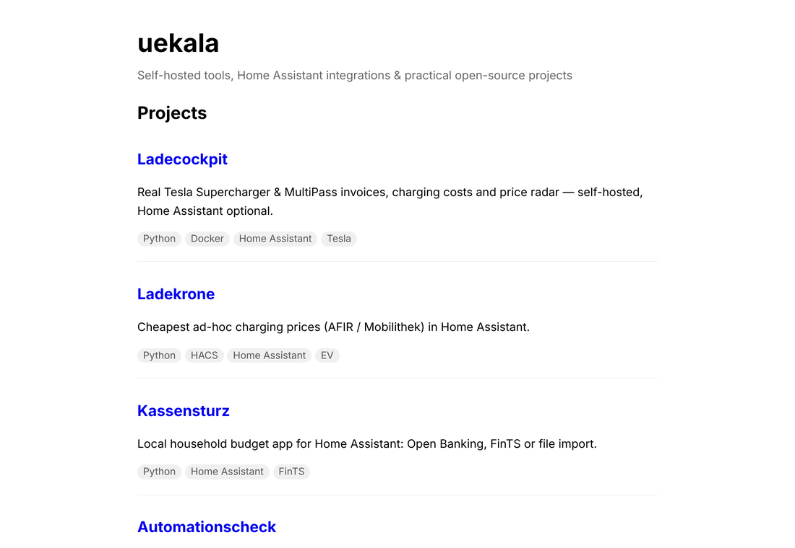

# Portfolio

Persönliches Portfolio, gebaut mit [Astro](https://astro.build).



## Projekte

- [Ladecockpit](https://github.com/uekala/ladecockpit) — Tesla-Laderechnungen und Preis-Radar
- [Ladekrone](https://github.com/uekala/ladekrone) — Günstigste Ladepreise für E-Autos in Home Assistant
- [Kassensturz](https://github.com/uekala/kassensturz) — Lokales Haushaltsbuch
- [Automationscheck](https://github.com/uekala/automationscheck)
- [HA Grok Update Check](https://github.com/uekala/ha-grok-update-check)
- [Exitcheck](https://github.com/uekala/exitcheck)

## Entwicklung

```bash
npm install
npm run dev
```

## Veröffentlichen

GitHub Pages oder Cloudflare Pages (statische Ausgabe).
